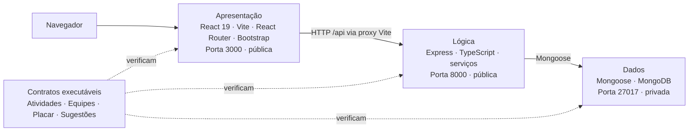

# Arquitetura do OctoFit Tracker

O OctoFit Tracker é uma aplicação de três camadas para um programa de atividades físicas escolar. O código inicial inclui contratos de API e pontos de implementação intencionalmente incompletos para que você use o modo agent do GitHub Copilot em um ciclo guiado por testes.

## Limites entre as camadas

- **Camada de apresentação**: React 19, Vite, React Router, Bootstrap e um cliente compartilhado da API em `octofit-tracker/frontend/src`.
- **Camada de lógica**: rotas e serviços Express com TypeScript em `octofit-tracker/backend/src` expõem o comportamento `/api/*` na porta `8000`.
- **Camada de dados**: modelos Mongoose e dados de demonstração em `octofit-tracker/backend/src/models` e `src/scripts/seed.ts` são persistidos no MongoDB na porta `27017`.

## Portas e regras de ambiente

- MongoDB: `27017` (privada)
- API Express: `8000` (pública)
- Interface Vite: `3000` (pública)
- O navegador acessa caminhos relativos `/api`. O Vite os encaminha para `http://localhost:8000`; `VITE_API_BASE_URL` pode substituir a URL-base.
- Não encaminhe nem torne públicas outras portas.

## Contrato da API

| Capacidade | Método e caminho | Comportamento esperado |
| --- | --- | --- |
| Registro de atividades | `GET /api/activities`, `POST /api/activities` | Lista e cria atividades válidas. POST recebe `userId`, `teamId`, `type` e `minutes`; `userId` e `teamId` devem ser IDs bem-formados de uma pessoa e uma equipe existentes, caso contrário a API retorna um 4xx intencional (nunca um 500 causado por erro de conversão). Uma atividade criada armazena `user`, `team`, `type` e `minutes` enviados, além de `points` e `occurredAt` calculados. |
| Equipes | `GET /api/teams`, `POST /api/teams` | Lista e cria equipes com integrantes. As equipes criadas e listadas mantêm os valores enviados em `name` e `mascot`. Rejeita uma equipe sem nome com `400`. |
| Placar | `GET /api/leaderboard` | Retorna as equipes ordenadas pela soma dos pontos de suas atividades, da maior para a menor. Cada item contém `teamName`, `totalPoints` e uma `rank` iniciada em 1. |
| Sugestões de treino | `GET /api/workouts/suggestions/:userEmail` | Recomenda treinos com base nos padrões de atividade recentes da pessoa correspondente ao e-mail seed. O foco da primeira sugestão (`focus`) corresponde à meta ou à atividade recente dessa pessoa, e o campo `reason` explica o motivo. Um e-mail sem pessoa correspondente retorna um 4xx intencional (por exemplo, `404`). |

## Decisões de implementação

Plano registrado antes da edição do código, com base nas falhas atuais dos testes.

- **Decisão da camada de apresentação:** substituir os placeholders por componentes que consultam a API pelo cliente compartilhado em `octofit-tracker/frontend/src/api/client.ts`, com estados de carregamento (`role="status"`), lista, estado vazio e alerta de erro (`role="alert"`). Os componentes não acessam o banco nem montam URLs manualmente.
- **Decisão da camada de lógica:** rotas em `octofit-tracker/backend/src/routes/api.ts` delegam a regra de negócio a `octofitService.ts`. Entradas inválidas retornam 4xx, nunca 500.
- **Decisão da camada de dados:** adicionar validações obrigatórias nos modelos Mongoose (`User`, `Team`, `Activity`, `Workout`) antes de qualquer alteração de API, porque os testes de contrato de dados dependem delas.
- **Abordagem para registro de atividades:** validar `userId` e `teamId` como ObjectId e confirmar que existem antes de salvar. Calcular `points` e `occurredAt` no serviço.
- **Abordagem para gerenciamento de equipes:** exigir `name` e `mascot` no `POST` e retornar `400` quando faltarem.
- **Abordagem para o placar:** agregar os pontos das atividades por equipe, ordenar do maior para o menor total e atribuir `rank` iniciando em 1.
- **Abordagem para sugestões de treino:** derivar `focus` da meta ou da atividade recente da pessoa encontrada pelo e-mail. Retornar `404` quando não houver pessoa correspondente.

Ordem de implementação: dados, depois lógica (equipes, atividades, placar, sugestões) e por último apresentação (cliente, `Activities`, `Teams`, `Leaderboard`, `Workouts`).

## Plano de testes

Comandos a executar, a partir da raiz do repositório, e o significado das falhas observadas.

- Testes da camada de dados: `npm run test:data --prefix octofit-tracker/backend`
- Testes da API: `npm run test:api --prefix octofit-tracker/backend`
- Testes do frontend: `npm test --prefix octofit-tracker/frontend`
- Compilação do backend: `npm run build --prefix octofit-tracker/backend`
- Compilação do frontend: `npm run build --prefix octofit-tracker/frontend`

### Última execução observada

- **Dados** (`tests/data.contract.test.ts`): 8 falhas e 1 aprovado. As falhas indicam que `validateSync()` não gera erro para `name`, `email`, `fitnessGoal`, `mascot`, `type`, `user`, `team`, `focus`, `minutes` e `difficulty`. Os modelos ainda não declaram esses campos como obrigatórios.
- **Frontend** (`tests/app.contract.test.tsx`): 15 falhas. Os componentes exibem o texto "Implementação pendente", sem chamadas à API, sem estado de carregamento, vazio ou de erro. Por isso `getByText`, `getByRole('status')`, `getByRole('alert')` e a chamada `fetch` para `/api/workouts/suggestions/mona@example.com` não encontram nada.

### Critério de aceite

- Os testes de dados passam antes de qualquer alteração na API.
- Os testes da API passam antes de qualquer alteração no frontend.
- Os testes do frontend e as duas compilações passam ao final.
